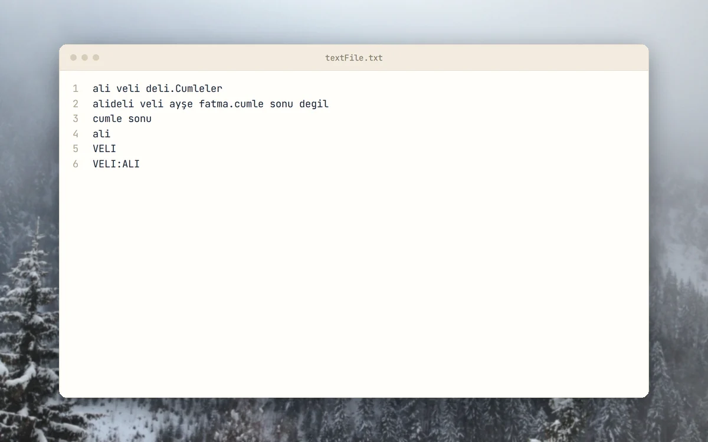
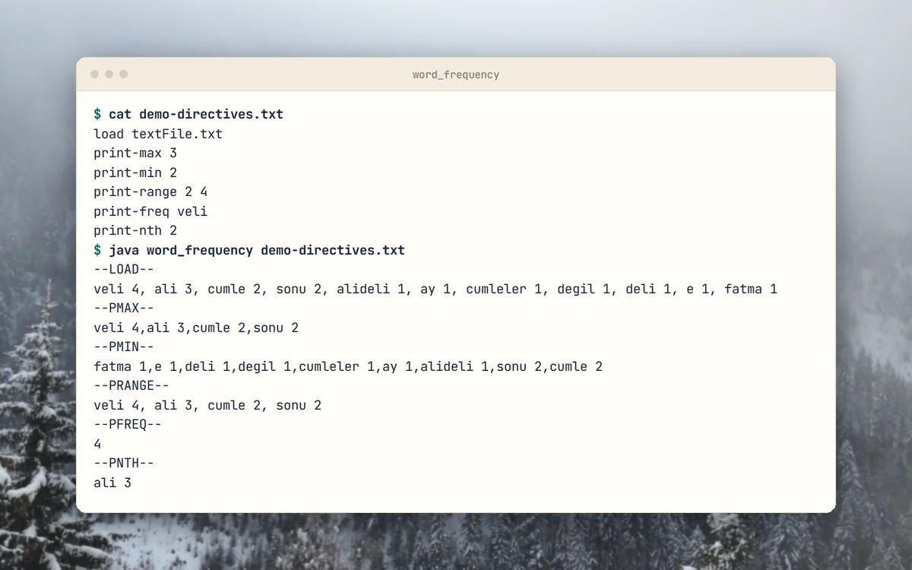
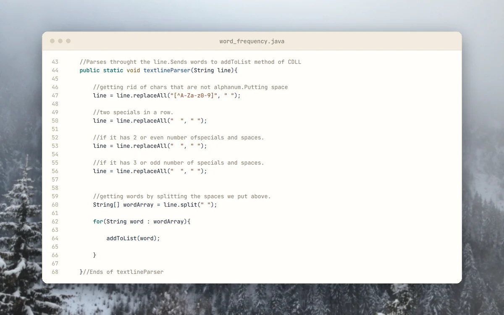

<p align="center">
  <picture>
    <source media="(prefers-color-scheme: dark)" srcset="docs/brand/svg/word-frequency-finder-logo-on-dark.svg">
    
  </picture>
</p>

<h1 align="center">Load a text file. Query its word frequencies.</h1>

<p align="center">
  Archived university assignment in Java, 2019.<br>
  <b>Seven directives. A circular doubly linked list written by hand.</b>
</p>

<p align="center">
  
  <a href="LICENSE"></a>
  
  
  <a href="https://github.com/mertkayacs/WordFrequencyFinder"></a>
</p>

<p align="center">
  <a href="#quick-start"></a>
  <a href="word_frequency.java"></a>
  <a href="https://mertkayacs.com/?utm_source=github&utm_medium=readme&utm_campaign=WordFrequencyFinder-repo&utm_content=portfolio-badge"></a>
</p>

Word Frequency Finder counts the words in a text file and answers questions about them from a directives file. The words live in a circular doubly linked list that the program keeps sorted by frequency. You can print the most or least frequent words, the words in a frequency range, the count of one word or the n-th most frequent word, and you can drop the rarest words. Case does not matter, and punctuation separates words.

---

## Why Word Frequency Finder

The program reads a text file and a script of questions about it.

|  |  |
|---|---|
|  **Directive driven** | One directive per line in a plain file. Run it once and the answers print to standard output. |
|  **Sorted while it counts** | [CircularDoublyLinkedList.java](CircularDoublyLinkedList.java) updates a word and moves it into place, so the list stays ordered by frequency. |
|  **Simple counting rules** | Every word is lower-cased, and any character that is not a letter or digit separates words. |

## A quick tour

<table>
  <tr>
    <td width="50%" valign="top">
      <picture>
        <source media="(prefers-color-scheme: dark)" srcset="docs/assets/readme/tour/input-dark.webp">
        
      </picture>
      <h3>Sample text</h3>
      The first six lines of textFile.txt, which the example directives load.
    </td>
    <td width="50%" valign="top">
      <picture>
        <source media="(prefers-color-scheme: dark)" srcset="docs/assets/readme/tour/run-dark.webp">
        
      </picture>
      <h3>Directives and answers</h3>
      A directives file and the answers it produces in one run of word_frequency.
    </td>
  </tr>
  <tr>
    <td width="50%" valign="top">
      <picture>
        <source media="(prefers-color-scheme: dark)" srcset="docs/assets/readme/tour/parser-dark.webp">
        
      </picture>
      <h3>Splitting words</h3>
      Every character that is not a letter or digit becomes a space, then the line is split into words.
    </td>
    <td width="50%" valign="top">
      <picture>
        <source media="(prefers-color-scheme: dark)" srcset="docs/assets/readme/tour/list-dark.webp">
        
      </picture>
      <h3>Counting by frequency</h3>
      addFreq raises the count of a word, and the list then moves the node to its place.
    </td>
  </tr>
</table>

<p align="center"><sub>The terminal card shows real output of word_frequency. The other cards show files as they are in the repository.</sub></p>

## Features

**Directives**

| Directive | What it does |
|---|---|
| `load FILE` | Reads the words of FILE into the frequency list. |
| `print-max N` | Prints the N most frequent words with their counts, plus any word tied with the last one. |
| `print-min N` | Prints the N least frequent words with their counts. |
| `print-range N1 N2` | Prints the words whose count lies in the range, or says that the range is empty. |
| `print-freq WORD` | Prints the count of one word. |
| `print-nth N` | Prints the word with the N-th highest count. |
| `truncate-list N` | Removes the N least frequent words. |

## Quick start

Write a directives file, for example `my-directives.txt`:

```text
load textFile.txt
print-max 3
print-freq ali
```

Compile and run it:

```sh
javac *.java
java word_frequency my-directives.txt
```

### Requirements

- A Java JDK. The repository does not pin a version.

## FAQ

<details>
<summary><b>Why does the bundled directives.txt fail?</b></summary>

It loads text-file-1.txt, text-file-2.txt and text-file-3.txt. Those files are not in the repository. Use textFile.txt or your own text file.
</details>

<details>
<summary><b>Does case matter?</b></summary>

No. Every word is lower-cased before it is counted, and print-freq lower-cases its argument too.
</details>

<details>
<summary><b>What counts as a word?</b></summary>

A run of letters and digits. Any other character separates words.
</details>

If Word Frequency Finder is useful to you, a ⭐ helps other people find it.

## License

[GPL-3.0](LICENSE).

[](https://github.com/mertkayacs/WordFrequencyFinder)
